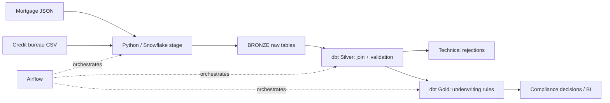

# Mortgage Application & Underwriting Pipeline

Reference implementation for the supplied case study using Snowflake, dbt, Python and Airflow infrastructure examples.

## Architecture

## Decision rules
- `LTV_PCT = loan_amount / property_value * 100`; decline when `> 95`.
- `DTI_PCT = monthly_debt / monthly_gross_income * 100`; decline when `> 43`.